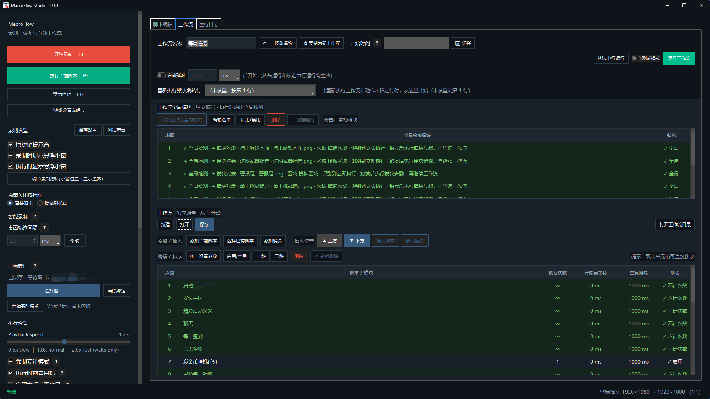

<div align="center">

# MacroFlow Studio

**Let scripts handle the repetition.**

Record keyboard and mouse actions on Windows, make decisions with image matching and offline OCR, and connect tasks with workflows.

[Quick start](#quick-start) · [User guide](docs/user-guide.en.md) · [Releases](https://github.com/SakuraLoveForever/MacroFlowStudio-/releases) · [简体中文](README.md)


</div>



## From recording to automation

**Record actions → Edit a script → Add conditions → Build a workflow**

| Capability | What you can do |
| --- | --- |
| Recording & playback | Capture keyboard, mouse and relative game camera movement; repeat by count |
| Script editing | Combine clicks, typing, delays and jumps; reference scripts or Python logic |
| Image matching & OCR | Choose the next action based on images, text or numbers, entirely offline |
| Reusable modules | Share recognition conditions and response actions across scripts |
| Workflows | Run scripts in sequence with counts, waits and global detection |

## Quick start

**Running the source?** Install dependencies, then double-click `run.bat` in the project root to use the current source. First-time setup is below.

**Using a release?** Download from [Releases](https://github.com/SakuraLoveForever/MacroFlowStudio-/releases), extract the whole folder and run `MacroFlowStudio.exe`. Keep all supplied runtime files and `rapidocr_ocr/`; copy the entire folder when moving the app.

1. **Select a window**: bind the application you want to automate.
2. **Record actions**: press `F8` to start / stop recording, then save your script.
3. **Run the script**: press `F9` to play it back; during execution, `F8` pauses / resumes.
4. **Connect tasks**: add scripts to a workflow, set repeat counts, then press `F10`.

> **Stop at any time with `F12`.** Hiding to the tray keeps tasks running; closing the window exits the app.

## Explore as needed

| Learn about | Documentation |
| --- | --- |
| Actions, recognition, modules and workflows | [User guide](docs/user-guide.en.md) |
| Writing Python logic with `main(ctx)` | [Python API & examples (中文)](docs/python-scripts.md) |
| Dependencies, tests and build entry points | [Development guide](docs/development.md) |
| Source and runtime data locations | [Project layout (中文)](docs/project-layout.md) |
| Version changes | [Changelog](CHANGELOG.md) |

<details>
<summary><strong>First-time source setup</strong> · Windows / Python 3.13</summary>

Install the base and offline OCR dependencies from the project root:

```powershell
python -m pip install -r requirements.txt
C:\Python313\python.exe -m pip install --target .deps --no-deps -r requirements-ocr.txt
.\run.bat
```

`run.bat` loads `.deps` and `src`. Scripts, workflows, settings and logs are stored in the project root. OCR loads local models on first use.

</details>
